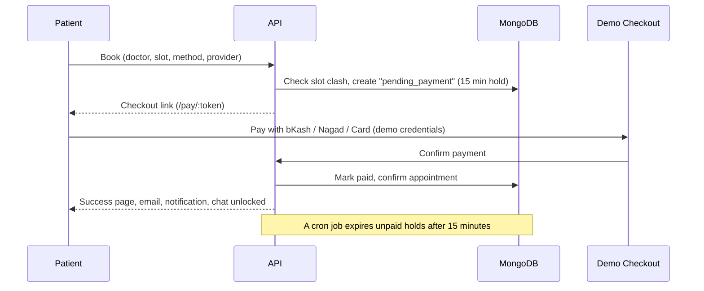
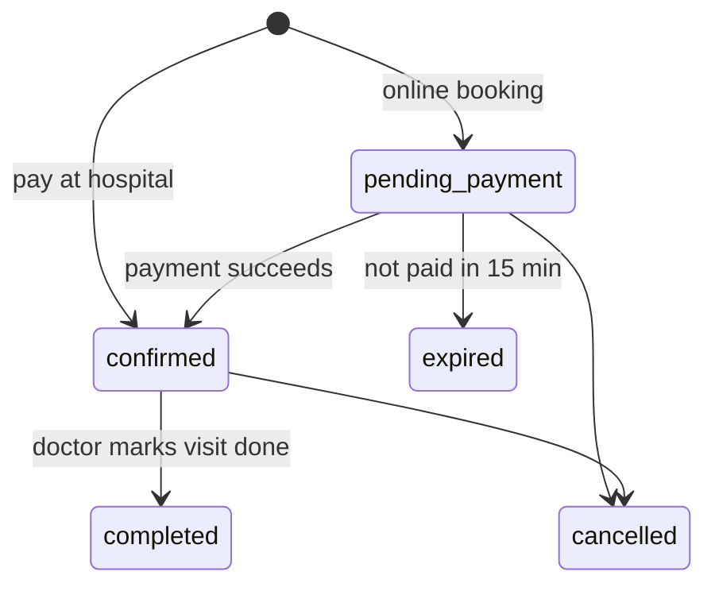

<div align="center">

# 🏥 Medicare

**A full-stack healthcare appointment platform with role-based dashboards for patients, doctors and admins.**

Find a doctor · Book a slot · Pay online (demo) · Chat in real time · Manage everything from one place

<br />


[Live Demo](https://neon-empanada-194952.netlify.app/) · [Screenshots](#-screenshots) · [Features](#-features) · [Getting Started](#-getting-started)

</div>

---

## 📖 Table of Contents

- [About](#-about)
- [Screenshots](#-screenshots)
- [Features](#-features)
- [Tech Stack](#-tech-stack)
- [How It Works](#-how-it-works)
- [Project Structure](#-project-structure)
- [Getting Started](#-getting-started)
- [Demo Payment Credentials](#-demo-payment-credentials)
- [API Overview](#-api-overview)
- [Known Limitations & Roadmap](#-known-limitations--roadmap)
- [Author](#-author)

---

## 📌 About

Medicare connects patients with doctors. Patients search for a specialist, pick an available slot from the doctor's real schedule, pay online or at the hospital, and chat with the doctor afterwards. Doctors manage their appointments, patients and records. Admins oversee the whole system: doctors, patients, appointments, payments, messages and notifications.

> **Note:** Online payments use a **built-in demo gateway** (bKash, Nagad and international card flows). No real money is ever charged.

---

## 📸 Screenshots

> Replace the paths below with your own images (e.g. put them in `docs/screenshots/`).

| Landing & Doctor Search | Doctor Profile & Booking |
| :---: | :---: |
|  |  |

| Demo Checkout (bKash / Nagad / Card) | Printable Receipt |
| :---: | :---: |
|  |  |

| Patient Dashboard | Doctor Dashboard |
| :---: | :---: |
|  |  |

| Admin Overview | Real-time Chat |
| :---: | :---: |
|  |  |

---

## ✨ Features

### 👤 Patients
- Search and filter doctors by department, gender, experience, rating, fee and location, with sorting and pagination
- Doctor profile with education, experience and a **schedule-aware booking calendar** (only the doctor's working days are selectable)
- Book with **online payment** or **pay at hospital**
- My Appointments: upcoming, completed and cancelled, with cancel, book-again and details
- Printable **payment receipts**
- Medical records (prescriptions, lab reports, diagnoses) added by their doctors
- Real-time chat with doctors they have booked, with image and PDF attachments
- Live notifications and unread badges

### 🩺 Doctors
- Dashboard with today's load, a 7-day appointment chart, new vs returning patients and recent patients
- Appointments table with a calendar, mark as completed or cancel
- Patient list with appointment history and records
- Add prescriptions, lab reports and diagnoses (with file attachments) straight from a patient's chat
- Notified instantly about new bookings, cancellations and messages

### 🛠️ Admins
- Overview with trends, patient mix, department breakdown, recent appointments and activity
- **Doctors management**: search, filter, change status (active / on leave / inactive), safe delete
- **Patients management**: search, filters, detail view, CSV export
- **Appointments management**: filters, calendar with counts, complete or cancel, CSV export
- **Payments and revenue**: totals, payment methods, revenue by department, monthly revenue, pending payments and refunds due
- **Read-only monitoring** of all patient-doctor conversations and all notifications
- Invite-based doctor onboarding (the doctor receives an email link and sets their own password)

### 🔐 Platform
- Custom **JWT auth** with access and refresh token rotation (httpOnly cookies)
- Email verification, forgot and reset password, Google and GitHub OAuth
- Role-based access control on both the API and the UI
- Double-booking prevention and a **15-minute payment hold** that is released automatically by a cron job
- Confirmation emails (Nodemailer) and file uploads (Cloudinary)
- One shared **Socket.io** connection powering chat and live notifications
- Responsive UI with a mobile menu

---

## 🧰 Tech Stack

| Layer | Technologies |
| --- | --- |
| **Frontend** | React, React Router, Tailwind CSS, TanStack React Query, Axios, Lucide Icons, Socket.io Client |
| **Backend** | Node.js, Express, MongoDB (native driver), Socket.io, node-cron |
| **Auth** | Custom JWT (access + refresh), bcrypt, Google and GitHub OAuth |
| **Services** | Nodemailer (SMTP), Cloudinary (uploads) |

---

## 🔄 How It Works

### Booking and payment flow



### Appointment lifecycle



### Chat rules
- A conversation is created automatically once an appointment is confirmed
- Patients can only message doctors they have booked
- Admins can read every conversation but **cannot send messages**

---

## 📁 Project Structure

> Simplified. Adjust folder names to match your repository.

```
Medicare/
├── backend/
│   ├── controllers/     # auth, doctors, appointments, payments, chat, records, dashboards...
│   ├── model/           # MongoDB repositories
│   ├── routes/          # Express routers
│   ├── middleware/      # auth + role guards
│   ├── utils/           # email, cloudinary, socket, cron jobs, notifications
│   └── index.js
└── frontend/
    └── src/
        ├── hooks/       # useAuth, useAxiosSecure, useSocket, useBadgeCounts
        ├── layout/      # Sidebar, TopNavbar, global search, mobile menu
        ├── Pages/       # public pages + patient / doctor / admin dashboards
        └── router.jsx
```

---

## 🚀 Getting Started

### Prerequisites
- Node.js 18+
- A MongoDB database (local or Atlas)
- A Cloudinary account (for file uploads)
- An SMTP account, e.g. a Gmail app password (for emails)

### 1. Clone

```bash
git clone https://github.com/kawser-ahmed-nihad/Medicare.git
cd medicare
```

### 2. Backend

```bash
cd backend
npm install
cp .env.example .env     # then fill in the values
npm run dev              # runs on http://localhost:3000
```

### 3. Frontend

```bash
cd frontend
npm install
npm run dev              # runs on http://localhost:5173
```

### Environment variables (`backend/.env`)

> Use the same variable names your code reads. This is an example.

```env
PORT=3000
CLIENT_URL=http://localhost:5173

MONGODB_URI=mongodb+srv://<user>:<password>@<cluster>/medicare

JWT_ACCESS_SECRET=change_me
JWT_REFRESH_SECRET=change_me_too
INVITE_EXPIRES_HOURS=72

SMTP_HOST=smtp.gmail.com
SMTP_PORT=587
SMTP_USER=you@gmail.com
SMTP_PASS="your app password"   # quote it if it contains spaces

CLOUDINARY_CLOUD_NAME=
CLOUDINARY_API_KEY=
CLOUDINARY_API_SECRET=

GOOGLE_CLIENT_ID=
GOOGLE_CLIENT_SECRET=
GITHUB_CLIENT_ID=
GITHUB_CLIENT_SECRET=
```

### Creating an admin
Register a normal account, then set `role: "admin"` on that user in the `users` collection. Doctors are added by the admin from **Doctor Management → Add Doctor** and receive an email invite to set their password.

---

## 💳 Demo Payment Credentials

The checkout page is a **simulation**. Use these test values:

| Method | Details |
| --- | --- |
| **bKash** | Any number like `01712345678` · OTP `123456` · PIN `12345` |
| **Nagad** | Any number like `01712345678` · OTP `123456` · PIN `1234` |
| **Card (success)** | `4242 4242 4242 4242` · any future expiry · any CVV |
| **Card (declined)** | `4000 0000 0000 0002` |

The card form accepts **only** these test numbers, and card details are never stored or logged.

---

## 🔌 API Overview

| Area | Highlights |
| --- | --- |
| **Auth** | register, verify email, login, refresh, logout, forgot and reset password, OAuth, doctor invite |
| **Doctors** | public search with filters, profile, admin list, status change, delete |
| **Appointments** | create, my appointments, doctor appointments, cancel, complete, admin list and calendar |
| **Payments** | demo checkout session, confirm, cancel, receipt, admin revenue summary and list |
| **Conversations** | start, list, messages, send, upload, unread count, admin monitor |
| **Medical Records** | doctor adds a record, patient reads their records |
| **Notifications** | list, mark read, mark all read, admin list (real-time via Socket.io) |
| **Dashboards** | patient, doctor and admin summaries |

---

## ⚠️ Known Limitations & Roadmap

**Current limitations**
- Payments are simulated. A real gateway (bKash, Nagad or a card processor) would need merchant accounts and a server-side verification step
- Refunds are flagged as "Refund Due" but are not automated
- Cash payments count as revenue once the doctor marks the visit completed
- No automated test suite yet

**Roadmap**
- [ ] Doctor reviews and ratings
- [ ] Real payment gateway integration and automated refunds
- [ ] Patient vitals tracking
- [ ] Reminders (email and push) before appointments
- [ ] Redis adapter for horizontally scaling Socket.io
- [ ] Unit and integration tests, CI pipeline, Docker setup

---

## 👨‍💻 Author

**Your Name**

[GitHub](https://github.com/kawser-ahmed-nihad) · [LinkedIn](https://www.linkedin.com/in/kawser-ahmed-nihad) · [Portfolio](https://kawser-ahmed-nihad.netlify.app/)

---

<div align="center">

If you found this project useful, consider giving it a ⭐

</div>
